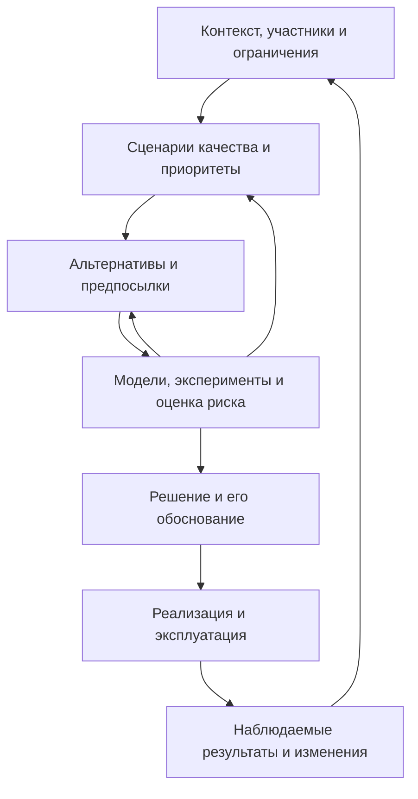

# Что уже известно и что именно можно формализовать

**Роль материала после ревью:** фоновая карта направлений. Основная [проблема](00-research-brief.md) — проверяемое основание выбора между архитектурными альтернативами. Проверка аргументов поддерживает сравнение, но не заменяет его. Чтение всех направлений ниже не является обязательным; [минимальный маршрут](05-learning-path.md) выделен отдельно.

## Предварительный ответ

Область имеет развитые методы описания архитектуры, выявления требований к качеству, оценки компромиссов, фиксации решений и проверки отдельных свойств. Поэтому начинать с предположения, что архитектурный процесс вообще не исследован, было бы ошибкой. Опорные направления представлены работами [L03–L16](02-literature.md).

Более сильное утверждение — что существует универсальная процедура, гарантирующая нужное качество любой исходной архитектуры, — эта карта не подтверждает. Нельзя также объявлять его невозможным лишь потому, что архитекторы спорят. Нужно отдельно исследовать постановку целей, корректность моделей, полноту альтернатив и условия гарантий.

Это концептуальный синтез известных направлений, а не вывод из проведённого систематического обзора. Статус источников и ограничения актуальности — в [библиографии](02-literature.md).

При ревью проверен конкретный пример: ATAM требует связывать решение с качественным требованием и rationale (§7.1, §8.6), одновременно оставляя engineering judgement (§8.6) и завися от входной информации (гл. 12). Это показывает, что процедура действительно содержит ограничения, но не устанавливает их достаточности или универсальной эффективности. Исследование Borowa и соавторов (2025) оценивает отдельное вмешательство в архитектурную аргументацию. [Разбор свидетельств](10-core-source-notes.md) отделяет его исходы от качества готовой системы.

## Четыре разных вопроса за словом «формализовать»

| Вопрос | Подходы | Какой результат возможен | Чего результат не устанавливает |
| --- | --- | --- | --- |
| Как одинаково описывать архитектуру? | ISO/IEC/IEEE 42010, viewpoints, ADL, модели компонентов и связей [L05, L06, L13] | Явные понятия, правила описания и связи между представлениями | Что описанное решение удовлетворяет целям |
| Как выразить качество? | Модели качества, сценарии, SLO, модели нагрузки и изменения [L07, L08] | Проверяемые требования для заданного контекста | Что выбраны все нужные требования и правильные приоритеты |
| Как выбирать решение? | ADD, ATAM, CBAM, анализ решений, Pareto, чувствительность [L09–L12, L17] | Сопоставление альтернатив и прослеживаемое обоснование | Что рассмотрены все альтернативы и будущее предсказано правильно |
| Как проверить отдельное свойство? | Доказательства, model checking, моделирование, прототипы, измерения [L14–L16] | Доказательство относительно модели или эмпирическая оценка | Полное качество продукта, организации и эксплуатации |

Шаблон ADR — структурирование аргумента. TLA+ — язык с математической семантикой. Они формализуют разные части работы и не взаимозаменяемы.

## Архитектурный процесс как система с обратной связью

Эта схема — рабочий синтез, не новая признанная теория. Близкое направление для проверки — общая модель архитектурного проектирования, полученная из пяти промышленных подходов [L12].

Практически полезен и граф прослеживаемости: интерес участника → требование → сценарий → решение → проверка. Он позволяет найти решения без основания и требования без проверки. Само наличие связей ещё не доказывает качество их содержания.

## Где находится «объективное качество»

Нужно разделить три уровня:

1. **Наблюдение:** при заданной нагрузке p99 времени ответа составил определённое значение. Здесь проверяются инструмент, выборка и воспроизводимость.
2. **Предсказание:** модель предполагает определённое поведение при другой нагрузке. Здесь проверяются предпосылки, калибровка и неопределённость.
3. **Предпочтение:** для этого продукта задержка важнее стоимости или скорости изменений. Здесь требуется легитимное согласование целей.

Последний уровень не становится физическим фактом после записи весов в таблицу. Но его можно сделать явным, согласованным и проверяемым на последовательность. Субъективный выбор целей совместим со строгой оценкой соответствия этим целям.

Даже конкретная метрика не полностью определяет качество: p99 без периода измерения, распределения запросов, уровня ошибок и правил исключения таймаутов допускает несовместимые трактовки. «Изменяемость» без класса ожидаемых изменений особенно трудно оценивать.

## Как сравнивать альтернативы без ложной точности

Пусть для архитектуры a в контексте c и будущем сценарии ω определён вектор:

`Q(a, c, ω) = (latency, reliability, change_cost, operating_cost, …)`.

Сначала отделяем обязательные ограничения от предпочтений. Недопустимый вариант не становится допустимым благодаря высоким баллам по другим показателям. Для допустимых вариантов:

- доминирование помогает исключить альтернативу, не лучшую ни по одной выбранной цели;
- Pareto-набор оставляет компромиссы для обсуждения;
- функции полезности помогают выбирать только при обоснованном способе сравнения и согласованных предпочтениях;
- анализ чувствительности показывает, при каких изменениях предпосылок выбор меняется;
- анализ устойчивости и сожаления может помочь при недостаточных основаниях для точных вероятностей.

Числа в оценочной матрице должны иметь основание: измерение, модель, данные похожих изменений или явная экспертная оценка с диапазоном. Усреднение порядковых баллов «1–5» не создаёт объективной шкалы. Доминирование относительно нескольких метрик тоже не исключает пропущенных факторов.

Эти инструменты из теории решений [L17] предлагаются как направления изучения. Их применение к конкретному архитектурному кейсу нужно обосновать; универсальная результативность здесь не установлена.

## Основные исследовательские линии

| Линия | Центральный вопрос | Начальные источники | Граница |
| --- | --- | --- | --- |
| Теория проектирования | Как проектировать при ограниченной информации и нескольких целях? | Simon; Rittel и Webber [L01–L02] | Общая теория не заменяет знания о программных системах |
| Модульность | Какие решения скрывать за границами модулей? | Parnas [L03] | Нет автоматического выбора всех границ системы |
| Архитектура как отдельный предмет | Что составляет архитектуру и как её анализировать? | Perry и Wolf; Shaw и Garlan [L04, L18] | Концептуальные основы не являются гарантией процесса |
| Требования и оценка качества | Как сделать требования операциональными и выявить компромиссы? | SEI, ATAM, ADD, модель качества [L07–L10] | Полнота сценариев и прогнозы остаются предпосылками |
| Архитектурные решения | Как сохранять rationale, зависимости и историю? | Jansen и Bosch; ADR [L11, L19] | Запись не делает аргумент истинным |
| Формальные методы | Какие свойства поведения можно проверить? | Lamport; практика AWS; TLA+ [L14–L16] | Корректная модель может не отражать реализацию |
| Экономика | Как учитывать стоимость, пользу и неопределённость? | CBAM; анализ решений [L09, L17] | Значения и вероятности требуют обоснования |
| Социотехнические связи | Как организация ограничивает архитектуру и её изменение? | Conway; исследования congruence [L20–L21] | Наблюдаемая связь не равна универсальному причинному закону |
| Эмпирическая оценка методов | Есть ли свидетельства улучшения решений и результатов? | Обзоры методов; методология обзоров [L22–L23] | Нужны свежие исследования и оценка угроз валидности |

C4, UML, DDD, паттерны, fitness functions и архитектурные линтеры полезно изучать после этой карты по конкретной задаче. Диаграммы помогают общению; линтеры проверяют явно заданные правила; ни одно из этих средств само по себе не отвечает на весь главный вопрос.

## Почему споры могут сохраняться при наличии методов

Пока это альтернативные объяснения для проверки, а не установленные причины:

- участники спорят о разных целях, скрывая их за одним словом «качество»;
- используют разные представления о будущем и нагрузке;
- сравнивают разные уровни: концептуальный стиль, реализованную систему или способность команды её поддерживать;
- обсуждают привычные решения без явных альтернатив и свидетельств;
- расходятся в отношении к риску, обратимости решения и цене ошибки;
- известные методы дороги, плохо адаптированы или не освоены конкретной командой;
- исследования самих методов ограничены контекстом, выборкой или качеством измерений.

Для проверки нужно наблюдать реальные обсуждения, кодировать типы разногласий и проверять изменение после введения методов. Одних мнений о «культуре» недостаточно.

## Что остаётся выяснить

**Личные пробелы, которые уже можно закрывать:** язык сценариев качества, различие архитектуры и её описаний, ATAM/ADD, rationale, моделирование неопределённости, границы формальных доказательств.

**Кандидаты в открытые вопросы:** насколько методы повышают согласие независимых оценщиков; как выбирать достаточный набор сценариев; когда затраты на анализ окупаются; как предсказывать стоимость изменений; как совместить автоматические проверки с меняющимися целями. Называть их открытыми для науки окончательно можно только после поиска актуальной литературы.

**Необоснованные обещания, которых следует избегать:** «метрики устраняют все споры», «ATAM доказывает качество», «формальная модель гарантирует весь продукт», «никаких объективных критериев не бывает», «вся индустрия уже решила вопрос». Ни одна из этих формулировок не следует из представленной карты.
